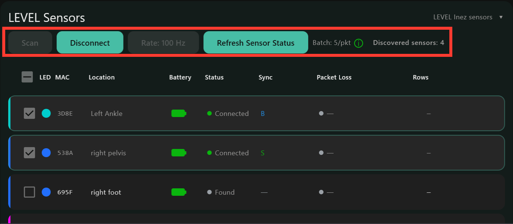

# LEVEL Sensors

## How it connects

LEVEL Inez sensors talk to the **LEVEL Hub** (USB, plugged into the PC) over
Bluetooth. One sensor acts as the **time beacon**; the others follow its clock,
so all sensors share one timeline, to a few milliseconds. The PC's arrival time
of every packet is saved too, which ties the sensors' clock to the PC clock, the
timeline every other system is aligned to.

## Before you start

You need:

- charged LEVEL Inez sensors (see [About Sensors](about-sensors.html)). Pick
  one up to wake it: an asleep sensor has no light and will not be found;
- the **LEVEL Hub** plugged into the PC. A direct USB port is better than a
  hub.

Settings that matter, on the Settings tab:

| Setting | Use |
|---|---|
| **Collector Settings > On launch** | **Scan** and **Connect** switches: do that for you when the Collector opens |

## How to connect

1. In the **Collect** tab's LEVEL Sensors panel, press **Scan** (or **Scan All**
   at the top). Found sensors are listed. The sensors from your last recording
   are ticked for you.
2. Tick or untick sensors as needed.
3. Set **Rate** if you need something other than 100 Hz. The rates on offer
   narrow as you tick more sensors.
4. Press **Connect** (or **Connect All**). Each sensor's light goes solid and its
   row shows **Connected**.
5. While connected, click a sensor's **LED** or **Location** cell to set its
   colour and where it is worn; both are saved on the sensor and in the
   session files.

## Calibration

None.

## How to stream

**Start Stream** starts the take on every connected sensor; **Stop Stream**
ends it and writes the files. The sensor table shows each sensor while it
streams:

| Column | What it shows |
|---|---|
| LED | the sensor's colour (click to change; only while connected) |
| MAC | the 4-character ID printed on the sensor |
| Location | where it is worn (click to set; only while connected) |
| Battery | charge level; recharge at LOW |
| Status | Found / Connecting / Connected / Streaming |
| Sync | **B** = the time beacon, **S** = following it, then its offset from the beacon in ms. A red **✗** means the sensor is not time-synced: disconnect and reconnect it. A red **⚠** with a number means it drifted off the beacon during the take. |
| Packet Loss | data lost on the way to the PC; red above 0.1% |
| Rows | samples written this take |

During a take the Sync offset should stay near 0; a red **⚠** with a number
means that sensor drifted off the beacon at some point; consider re-taking.

What each light pattern on the sensor means, plus waking and resetting a sensor:
[About Sensors](about-sensors.html#led-light-patterns).

## Files generated

| File | What |
|---|---|
| `imu-<location>-<id>.csv` | one per sensor: time, accelerometer, gyroscope, magnetometer, sensor time, PC arrival time |
| `meta-summary.json`, `meta-debug.json`, `meta-telemetry.csv` | session details, time-sync record, data-quality log |
| `sync.json` | which systems were in the take, which one started it, and for Sony the LTC output and the LTC camera |

## Post-processing

Align writes to `aligned\<session>\` beside `data\` in the root folder; the raw
session folder is never changed.

- Each sensor file has the sensor's own time, the PC arrival time of every
  packet, and a `time` column already placed on the PC clock when the take
  started. **Align to PC clock** leaves the sensor files alone.
- For takes of 5 minutes or longer, **Align to PC clock** also refits the
  sensor clock to the PC clock over the whole take (the sensor crystal drifts a
  few tens of ms per 10 minutes) and writes `aligned/imu_fitted-*.csv` with a
  `time_host_fitted` column. Shorter takes are left as recorded.

## FAQs

**No sensors found.** Wake them (pick them up), then Scan again. Sensors held by
a phone or another computer do not show; disconnect them there first.

**A sensor shows a red ✗ in Sync.** Press Disconnect, then Connect again.

**During a take the sensors drop out.** The LEVEL card turns red and says so.
The other systems keep recording; press **Stop Stream** when you decide to end
the take.

**Packet Loss is red.** Lower the rate or use fewer sensors, move the Hub to a
direct USB port, or bring the sensors closer; outdoors a few percent is normal.
