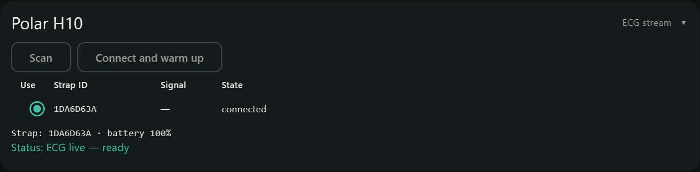

# Polar H10

## How it connects

The strap connects to the **PC's own Bluetooth** (not the LEVEL Hub). It
connects when you connect the IMU sensors and stays connected across takes. Each
take gets its own ECG, accelerometer and heart-rate files, and **Align to PC
clock** puts them on the same clock as the IMU sensors.

## Before you start

You need:

- a Polar H10 strap with a working battery;
- a PC with Bluetooth, running the Collector with the **full** Python
  environment (see [Settings](windows-settings.html#python-interpreter)).

We assume you already use the strap on its own: fitting it, wetting the
electrodes and battery changes are in Polar's
[H10 user manual](https://support.polar.com/e_manuals/h10-heart-rate-sensor/polar-h10-user-manual-english/getting-started.htm)
and [support pages](https://support.polar.com/en/support/h10_heart_rate_sensor).
Polar's own [pairing instructions](https://support.polar.com/e_manuals/h10-heart-rate-sensor/polar-h10-user-manual-english/pairing.htm)
cover phones and watches; pairing with a PC is the one step Polar does not
document, so it is here.

**Pair the strap with Windows once per PC.** The strap only sends ECG and
accelerometer data over a paired link. If it is not paired when you connect,
Windows asks to pair; allow it, or the strap does not start.

1. Put the strap on with the electrodes wet. It only appears while worn.
2. Windows **Settings > Bluetooth & devices > Add device > Bluetooth**, pick
   **Polar H10 \<ID\>** (the ID is printed on the pod).
3. If pairing fails: remove the strap in Windows, take the pod's battery out for
   10 seconds, and pair again.

## How to connect

1. **Settings > Sync:** tick **Polar H10**.
2. On the **Collect** tab, press **Scan All** (or **Scan** in the Polar panel).
   The straps in range are listed with their signal strength. Pick yours
   (**Use**). The Collector remembers the strap it last connected to.
3. Press **Connect All**. The strap connects with the IMU sensors and warms up.
   **Connect and warm up** in the Polar panel does the same for the strap alone,
   without touching the IMU sensors (it is available once the Collector has
   found the LEVEL Hub).

## Calibration

None. The strap needs a **warm-up of about 30-40 seconds** after connecting
before ECG flows; the sidebar shows it in yellow (searching, connecting,
warming up) and turns green when ECG is about 130 Hz, accelerometer about 200 Hz
and heart rate is arriving. Start the take once it is green.

## How to stream

Press **Start Stream**. The strap is already connected, so its streams are
simply cut at the take's start and stop. Right after the warm-up the ECG rate
can read low for a few seconds before it settles; that is normal. Between
takes the strap stays connected and warm.

## Files generated

| File | What |
|---|---|
| `polar_<mac>_ecg_<time>.csv` | ECG at about 130 Hz: PC arrival time, strap time, ECG |
| `polar_<mac>_acc_<time>.csv` | accelerometer at about 200 Hz: PC arrival time, strap time, X, Y, Z |
| `polar_<mac>_hr_<time>.csv` | heart rate and beat-to-beat (R-R) intervals, with PC arrival time |
| `aligned\polar_<mac>_<kind>_pc.csv` | after Align: the same rows with PC time |

`<mac>` is the strap's Bluetooth address (with `_` in place of `:`), not the ID
printed on the pod.

## Post-processing

Align writes to `aligned\<session>\` beside `data\` in the root folder's
`collector` folder (by default `C:\lvlmotion\collector\aligned\`); the raw
session folder is never changed.

- Every row has the strap's own timestamp and the PC time it arrived.
- **Postproc > Align to PC clock** writes `aligned\polar_<mac>_<ecg|acc|hr>_pc.csv`:
  the same rows plus a `pc_ms` column. It maps the strap's clock onto the PC
  clock along the fastest arrivals, which removes most of the Bluetooth delay.
  Heart rate has no strap timestamp, so its `pc_ms` is the arrival time.
- Polar times are in **milliseconds**; IMU sensor times are in **microseconds**.
  Multiply Polar times by 1000 before comparing.

## FAQs

**The ECG stopped but heart rate keeps going.** The Collector restarts the ECG
stream by itself ("ECG stalled — restarting the stream"); nothing to do.

**The Polar line is red with "No ECG".** No ECG arrived for about 75 seconds.
Re-wet the electrodes or reseat the strap, then press **Connect and warm up** in
the Collect tab's Polar panel.

**The Polar line says "strap disconnected (Bluetooth link lost)".** Press
**Connect and warm up** to reconnect.

**The status says "Waiting for pairing".** Windows is asking to pair the strap:
click **Allow** on the Windows prompt.

**Only heart rate arrives, never ECG or accelerometer.** The strap is not
paired with Windows. Pair it as above.

**The strap is not listed after Scan.** It only advertises while worn with
wet electrodes, and only to one PC at a time if another device already holds
it. Check the battery if it still does not appear.
