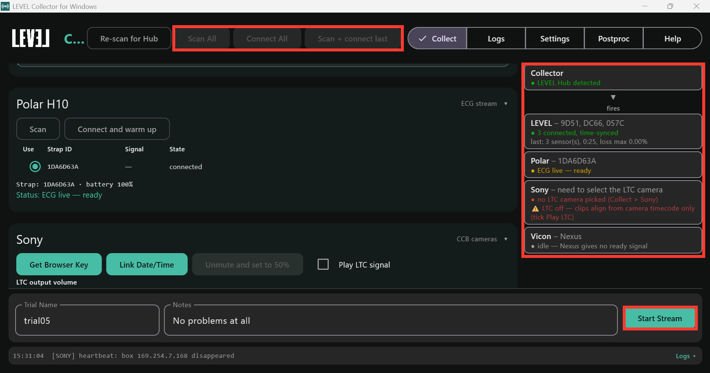
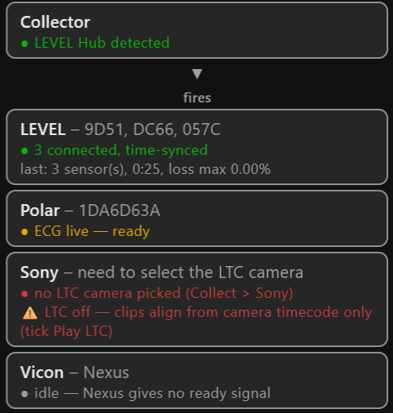

# Setting Up for a Recording

<strong>RETAKE SCREENSHOT #1 (on 0.1.41+): Vicon card reads "not connected — press Connect to Nexus" before Connect to Nexus is pressed (0.1.39 shows "idle — Nexus gives no ready signal"); Sony panel has Init rig / Pull all clips instead of Get Browser Key, Link Date/Time, Unmute</strong>

## Turn on the systems you are using

**Settings > Sync** lists every system. Tick the ones you use (Polar H10, Sony,
Vicon). With the Collector as the master, **Start Stream** on the Collector
starts everything. The table is explained on the [Settings](windows-settings)
page.

## Get everything ready

1. Prepare each system as its page describes:
   [LEVEL Sensors](windows-level-sensors.html), [Polar H10](windows-polar-h10.html),
   [Sony Cameras and Theia](windows-sony-theia.html), [Vicon](windows-vicon.html).
2. On the **Collect** tab, press **Scan All** (top of the window). It lists the
   sensors and straps in range and changes nothing. Each system has its own
   panel on the tab; pick what you want in each. The sensors and strap from
   your last recording are ticked for you once seen.
3. Get each system ready on its own panel: **Connect** for the LEVEL sensors,
   **Connect and warm up** for the Polar strap, **Init rig…** for Sony, and
   **Connect to Nexus** for Vicon once Nexus is Live. Some systems take a
   moment to get ready; each system's page says what to expect.

## The status sidebar

The right-hand panel shows every system you have turned on, and how each is
doing. The master is at the top; when it is not the Collector, an arrow leads
from it to the Collector, and the systems the Collector starts are listed
below. Each card reads **name - what you picked** (or what you still need to
pick), then a coloured status line, then any warnings.

<strong>RETAKE SCREENSHOT #2 (on 0.1.41+): Vicon card reads "not connected — press Connect to Nexus" (grey)</strong>

| Colour | Meaning |
|---|---|
| Green | ready, or recording and healthy |
| Yellow | warming up, in progress, or recording with a warning |
| Red | not ready or failed |
| Grey | nothing to report (e.g. Vicon before it is connected to Nexus) |

While a take is recording, the dot beside each system that is recording
blinks, at the same pace as a LEVEL sensor's light, and the Start/Stop bar at
the bottom of the Collect tab takes the colour of the worst system. The bar is
red after an unexpected disconnect, and grey otherwise.

| Card | Shows after the dash | Status line |
|---|---|---|
| Collector | - | whether the LEVEL Hub is plugged in |
| LEVEL | the sensors you picked | connected / time-synced / streaming with elapsed time and loss; after a take, its length and loss |
| Polar | the strap you picked | searching, warming up, then live ECG / ACC / heart rate |
| Sony | the camera carrying the LTC timecode audio | cameras ready / recording / problems, and whether LTC is playing |
| Vicon | Nexus | not connected until you press **Connect to Nexus**; then ready (Vicon's data rate) between takes; frames arriving during a take |

Nothing here stops you recording except a missing LEVEL Hub (the button then
reads **Awaiting LEVEL Hub**). If a line is red, it is your call whether to record
anyway.

## If something goes wrong

- **Collector says "no LEVEL Hub detected":** re-plug the LEVEL Hub, then press
  **Re-scan for Hub** (top of the window).
- **A system's card is red:** its page has the fixes for that system.
- **A system drops out during a take:** its card turns red and says so. The other
  systems keep recording; press **Stop Stream** when you decide to end the take.
