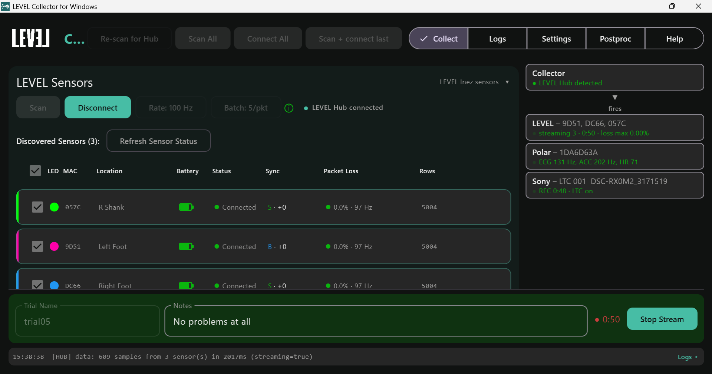

# Quick Start

A quick reference for a recording session, once each system's **Setup** is
done (see its page: [LEVEL Sensors](windows-level-sensors.html),
[Polar H10](windows-polar-h10.html), [Sony Cameras and Theia](windows-sony-theia.html),
[Vicon](windows-vicon.html)) and the systems you use are ticked in
**Settings > Sync** (see [Settings](windows-settings)).

<strong>RETAKE SCREENSHOT #1 (on 0.1.41+): Vicon card reads "not connected — press Connect to Nexus" before Connect to Nexus is pressed (0.1.39 shows "idle — Nexus gives no ready signal"); Sony panel has Init rig / Pull all clips instead of Get Browser Key, Link Date/Time, Unmute</strong>

**Plug the LEVEL Hub into the PC first.** With LEVEL sensors turned on, the
Collector cannot start a recording without it: the start button reads
**Awaiting LEVEL Hub** until the Hub is in.

## 1. Scan

On the **Collect** tab, press **Scan All** (top of the window). It lists the
sensors and straps in range and changes nothing. Pick what you want in each
panel: the LEVEL sensors, the Polar strap, and Sony's LTC camera. The sensors
and strap from your last recording are ticked for you once seen.

## 2. Initialize

Get each system ready on its own panel, in this order, and check it before the
take:

| System | Press | Calibrate or check |
|---|---|---|
| LEVEL Sensors | **Connect** | Every sensor shows **Connected** with **B** or **S** in Sync (a red **✗**: disconnect and connect again). The ⓘ next to Batch is green. |
| Polar H10 | **Connect and warm up** (Connect on the LEVEL panel does it too) | Wait about 30-40 seconds until the Polar card turns green (ECG live). |
| Sony | **Init rig…** | Pick the **LTC camera** in the Sony panel's camera list first. Before **Check LTC** runs, make the clock page full screen and point the LTC camera at it; Check LTC reads **OK** and saves K_av. Point the camera back. The **ptp** line reads **grandmaster heard**. Measure K_av again whenever the LTC signal restarts. |
| Vicon | Put Nexus in **Live** (armed and locked), then **Connect to Nexus** | The Vicon card reads **ready**. A short test take reads **receiving**. |

Each system's **Initialize** section has the details.

## 3. Collect

1. Check the **status sidebar** (below): start when everything you need is
   green or yellow.
2. Type a **Trial Name** (it names the session folder) and any **Notes**. When
   Vicon is the master, Nexus names the take and the field reads **Trial Name
   (Set By Nexus)**.
3. Press **Start Stream**. The Collector starts every system you turned on
   together. When Vicon or Sony is the master, start the take there instead;
   the button then reads **Listening For Vicon** or **Listening For Sony**.
4. Press **Stop Stream**. Everything stops; the sensors stay connected for the
   next take.

If a system fails mid-take, its sidebar card turns red and the others keep
going. Stop when you are ready. If the cameras are still recording when no take
is running, the main button still reads **Stop Stream** and stops them.

## Where the files go

Each take is a folder in the root folder's `collector\data` folder (by default
`C:\lvlmotion\collector\data\`; see [Settings](windows-settings)), named
`<date>_<time>-<trial name>`:

| Written | Files |
|---|---|
| During the take | one sensor file per sensor; Polar ECG, accelerometer and heart-rate files |
| At Stop | session details and quality summary; the Sony and Vicon timing records |
| After post-processing | `aligned\<take>\` beside `data\`, with every system's `*_pc.csv` |

What each system writes is listed on its page.

## The status sidebar

The right-hand panel shows every system you have turned on, and how each is
doing. The master is at the top; when it is not the Collector, an arrow leads
from it to the Collector, and the systems the Collector starts are listed
below. Each card reads **name - what you picked** (or what you still need to
pick), then a coloured status line, then any warnings.

| Colour | Meaning |
|---|---|
| Green | ready, or recording and healthy |
| Yellow | warming up, in progress, or recording with a warning |
| Red | not ready or failed |
| Grey | nothing to report (e.g. Vicon before it is connected to Nexus) |

While a take is recording, the dot beside each system that is recording
blinks, at the same pace as a LEVEL sensor's light, and the Start/Stop bar at
the bottom of the Collect tab takes the colour of the worst system. The bar is
red after an unexpected disconnect, and grey otherwise.

| Card | Shows after the dash | Status line |
|---|---|---|
| Collector | - | whether the LEVEL Hub is plugged in |
| LEVEL | the sensors you picked | connected / time-synced / streaming with elapsed time and loss; after a take, its length and loss |
| Polar | the strap you picked | searching, warming up, then live ECG / ACC / heart rate |
| Sony | the camera carrying the LTC timecode audio | cameras ready / recording / problems, and whether LTC is playing |
| Vicon | Nexus | not connected until you press **Connect to Nexus**; then the data Nexus streams in **Live** mode: ready (Vicon's data rate) between takes, frames arriving during a take |

**Vicon reads Nexus's Live stream.** Nexus streams the same data in Live mode
whether it is standing by or recording, so a green Vicon card means Nexus is
Live, not that Nexus is recording. Nexus does not tell the Collector when it
records.

## If something goes wrong

- **Collector says "no LEVEL Hub detected":** re-plug the LEVEL Hub, then press
  **Re-scan for Hub** (top of the window).
- **A system's card is red:** its page has the fixes for that system.
- **A system drops out during a take:** its card turns red and says so. The other
  systems keep recording; press **Stop Stream** when you decide to end the take.
