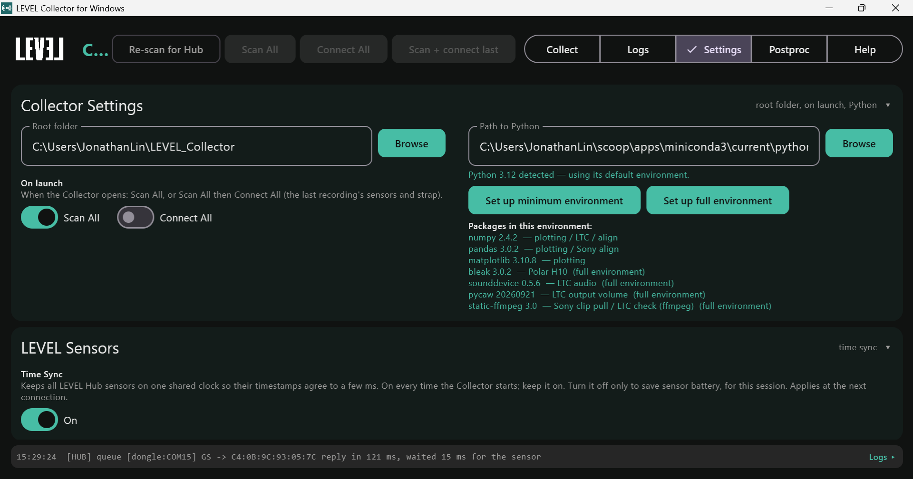
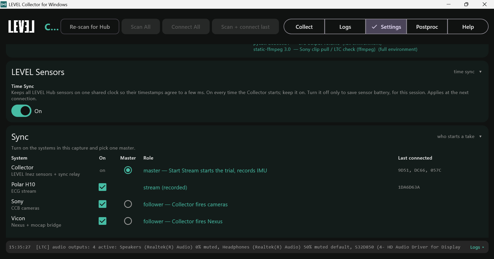
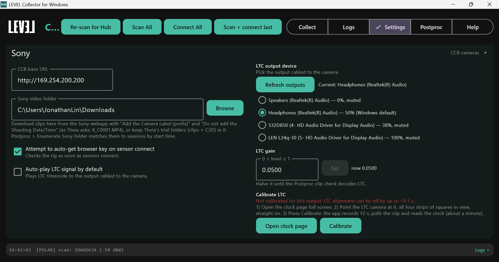

# Settings

The **Settings** tab is a stack of panels, each with a title you can click to
fold it away: **Collector Settings**, **LEVEL Sensors**, **Sync**, then one
panel for each other system that is on.

## Collector Settings

### Root folder

Where recordings and logs go: `data` and `logs` under this folder. The default
is `LEVEL_Collector` in your user folder. Type a path and press Enter, or
**Browse**. A new root applies to future recordings; existing ones stay where
they are.

### On launch

**Scan All**, or **Scan All** and **Connect All**, as soon as the Collector
opens: the same as pressing those buttons at the top of the window. Connect
All connects the sensors and strap of your last recording, so it needs the
LEVEL Hub plugged in and the sensors awake at launch.

### Python interpreter

The Collector needs a Python 3.10 or newer on the computer for plotting and for
the Polar, Sony and Vicon sidecars. Recording LEVEL sensors needs no Python. If
you do not have Python, install [Miniconda](https://www.anaconda.com/download/success)
(or any Python from [python.org](https://www.python.org/downloads/)) first.

The Collector shows which Python it found: the path saved here if you set one,
otherwise the Python that the `py -3` and `python` commands run (the one on
your PATH, which Miniconda and the python.org installer set up). **Browse**
picks a different one. It then checks that Python's default environment for the
packages it needs, listing each one as present or missing. If your Python
already has them, nothing more is needed. Otherwise click one of:

- **Set up minimum environment**: what plotting needs.
- **Set up full environment**: everything the other systems need, including
  the video tools used to read Sony clips.

Either one builds a private Python environment under your user folder
(`~/.lvlmotion`), installs the packages there, and switches the Collector to it.
Your own Python is never modified. It needs internet. The full environment downloads a few
hundred megabytes and can take several minutes; the line at the bottom of every
tab shows the latest step, and the **Logs** tab shows all of them. Wait for it
to say it finished.

If a package later shows as missing, run the same button again and restart the
Collector.

## LEVEL Sensors

**Time Sync** keeps every sensor on the Hub on one shared clock. On every time
the Collector starts; keep it on. Turning it off saves sensor battery for that
session only, and applies at the next connection.

## Sync

One take, several systems, one clock: the sync table says which systems are in
the capture and which one starts a take (the **master**). The Collector relays
the start to the others.

| Column | Meaning |
|---|---|
| **On** | the system is part of the capture. The Collector is always on. |
| **Master** | the one system whose start begins the take. Only one can be master. |
| **Role** | what that setting means for the row, in words. |
| **Last connected** | what that system connected to last: the sensors of the last recording, the Polar strap, the LTC camera. **Scan + connect last** reconnects to these. |

| System | Can be master | As master | Otherwise |
|---|---|---|---|
| **Collector** | yes | **Start Stream** starts the take and records the LEVEL sensors | relays the master's start, records the LEVEL sensors |
| **Polar H10** | no | - | an ECG stream, started with the take |
| **Sony** | yes | the camera web app leads; the Collector follows | the Collector fires the cameras |
| **Vicon** | yes | Nexus leads; the Collector follows | the Collector fires Nexus |

Keep the **Collector** as master unless the other system has to lead for its
own reasons (each system's page says when). The table locks while a take is
armed or recording; stop it to change the topology.

Turning a system on adds its panel below the table. The per-system pages
describe each one:

- **Polar H10**: nothing to set here; the strap is picked on the Collect tab,
  see [Polar H10](windows-polar-h10).
- **Sony**: the control box address, the Sony video folder (where the clips
  and Theia trial folders live) and the auto-start options on the left; the LTC
  output device, gain and calibration on the right, see
  [Sony Cameras and Theia](windows-sony-theia).

  
- **Vicon**: auto-arm and the DataStream SDK path on the left; the UDP port
  and the Nexus host on the right, see [Vicon](windows-vicon).
