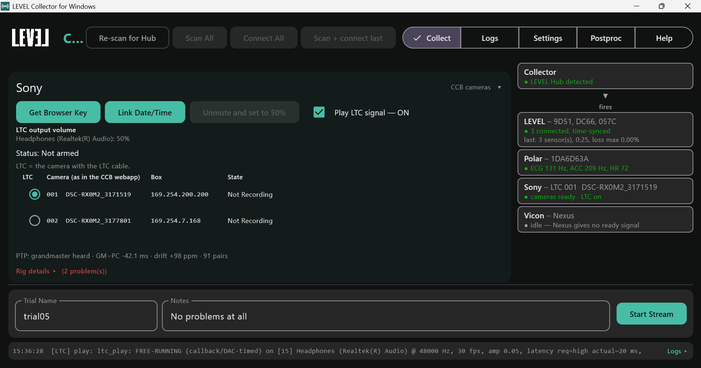
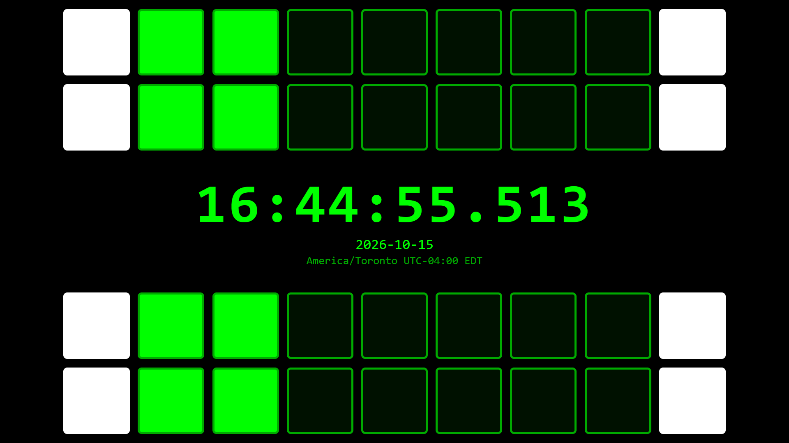
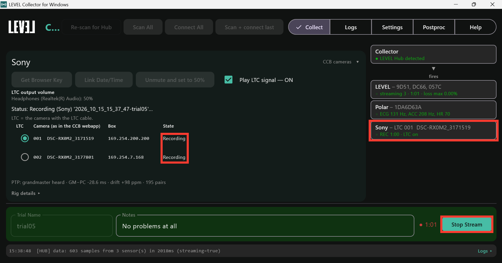

# Sony Cameras and Theia

## How it connects

- The PC joins the cameras' network and talks to the Sony **camera control
  boxes** (one per camera; the first one is the master, usually
  `http://169.254.200.200`). The Collector starts and stops every camera and reads
  each camera's state.
- For the tightest timing, the Collector plays a **timecode audio signal (LTC)**
  from a PC audio output into **one camera's microphone input**. That camera's
  clip then carries PC time in its audio. The camera's clock runs about
  **90 ppm** fast against the PC (about 5 ms per minute), but the LTC is read
  all the way through the clip, so the error stays within about **12 ms** at the
  start and under **10 ms** over a 20-minute take.
- Every camera also stamps its video with **timecode**, set by the control box
  from its own clock when recording starts. The Collector listens to that clock
  (PTP) the whole time and saves it with each take, so every take can be placed
  on the PC clock even without LTC. Two caveats:
  - it is good to about **60 ms**, not a frame. Between re-jams the camera's
    timecode gains about **6.6 ms per minute** on the control box clock, and
    the box pulls it back by about 60 ms every 10 minutes, so a take's offset
    depends on where in that cycle it started (plus about 15 ms either way);
  - the **first take after a camera is attached or powered on** can carry a
    timecode that is seconds stale. Wait 10 minutes after attaching or powering
    a camera before a take you will place by PTP alone, or use LTC, which is
    unaffected.

## Before you start

You need:

- Sony **RX0 II** cameras, each on a **CCB-WD1 camera control box**, wired
  through a network switch, with the Collector PC on that network;
- one **audio cable** from a PC audio output to the microphone input of one
  camera (the LTC camera). A **USB audio adapter** is the most reliable output;
  some built-in headphone jacks cut out when a camera is plugged in, even though
  they work with headphones;
- the Collector with the **full** Python environment (see
  [Settings](windows-settings.html#python-interpreter));
- a **Sony video folder** on the PC. By default it is `LEVEL_Collector\sony`
  under your user folder; **Settings > Sony** can point it elsewhere. **Pull all
  clips** on the Collect tab fills it (see below), or download the clips from
  the webapp the way Theia asks: **Add the Camera Label (prefix)** and **Do not
  add the Shooting Date/Time**, so they are named `<label>_C0001.MP4` (Theia's
  example: `8_C0001.MP4`; see Theia's
  [Format Sony Multicam](https://docs.theiamarkerless.com/theia3d-documentation/theia3d-dropdown-menus/tools-menu/format-sony-multicam)
  and [Organize Videos](https://docs.theiamarkerless.com/theia3d-documentation/theia3d-dropdown-menus/tools-menu/organize-videos)).
  Theia's organized trial folders (the clips plus the C3D) can live in the same
  folder.

We assume the rig already records on its own through the Sony webapp: cabling,
firmware, the master box and timecode sync are set up as Sony and Theia
describe:

- Sony: [CCB-WD1 Help Guide](https://helpguide.sony.net/dsc/1760/v1/en/index.html)
  and the RX0 II's [camera control boxes](https://helpguide.sony.net/dsc/1910/v1/en/contents/TP0002088375.html)
  page (USB Connection: PC Remote).
- Theia: [Sony Camera Package system setup](https://docs.theiamarkerless.com/theia3d-documentation/sony-camera-package/system-setup)
  and [data collection](https://docs.theiamarkerless.com/theia3d-documentation/sony-camera-package/data-collection).

What this page adds to that setup, once per rig:

- On the **LTC camera** (camera menu, Movie settings): **Audio Recording: On**
  (Theia's usual camera setup turns audio off, which removes the LTC);
  **Audio Rec Level: manual, about 26 of 30** (automatic level spoils the
  signal); **Audio Level Display** on if you want to see the LTC arriving.
  Plugging the cable into the microphone jack turns off that camera's own
  microphone.
- On the **PC**, turn off **Audio enhancements** for the LTC output (Windows
  **Settings > System > Sound**, pick the output, **Audio enhancements: Off**).
  Enhancements level the signal automatically and spoil the LTC. On the same
  output's **Advanced** page, leave **Allow applications to take exclusive
  control** on: the Collector needs it to play LTC.
- Allow **UDP ports 319 and 320** through Windows Firewall on the camera
  network, so the Collector can hear the control box clock (PTP).

## How to connect

1. **Settings > Sync:** tick **Sony**, with the Collector as master.
2. **Settings > Sony:** the control box address; the **LTC output** (press
   **Refresh outputs**, then pick the output cabled to the camera); the **LTC
   gain** (type it and press **Set**). Start at **0.016** with the output's
   Windows volume at 50%.
3. On the **Collect** tab, press **Scan All**: it gets the browser key (takes
   control of the cameras), sets the cameras' clocks from the PC and unmutes
   the LTC output at 50%. The Sony panel then lists the cameras as the webapp
   names them (e.g. `001  DSC-RX0M2_3177801`) with each camera's state.
4. Pick the **LTC** camera: the one with the audio cable. Tick **Play LTC
   signal** if you want LTC on this take.
5. The **PTP** line under the cameras should read **grandmaster heard** with
   the clock offset.
6. At the start of a session, press **Init rig…**. It gets the browser key,
   runs one-push autofocus on every camera, links the cameras' clocks to the
   PC, and then **formats every camera's memory card**. A dialog lists the
   cameras first: **Format and init**, **Init without formatting**, or
   **Cancel**. Pull the clips first if anything on the cards is still needed.
7. Press **Check LTC** to prove the timecode audio before recording. The
   Collector records a 12-second take, pulls the LTC camera's clip and reads
   the LTC in it: **OK** with the frame count and audio level, or what went
   wrong and what to change.

While LTC plays, the Collector takes the LTC output for itself (WASAPI
exclusive mode), so no other sound can land on the signal and the timing is
the same every time LTC starts. It never shares the output: if it cannot take
it, LTC does not start and the log says why. Usually the output is not an
active playback device, exclusive control is turned off for it in Windows
Sound > Advanced, or another program is holding it; fix that and tick **Play
LTC signal** again.

## Calibration

Camera calibration (intrinsic, extrinsic) is Theia's, as in Theia's
[calibration pages](https://docs.theiamarkerless.com/theia3d-documentation/data-collection/recording-extrinsic-chessboard-calibrations).
The Collector adds one optional measurement.

**No timing calibration is needed per session.** With the LTC output in its
default (exclusive) mode, the LTC camera's video lands within about **±12 ms**
of PC time, under one video frame at 60 fps, with no calibration at all.

**Calibrate LTC (optional, once per PC and LTC output).** It measures the small
remaining offset between the LTC in the audio and the video frames (K_av) for
your exact hardware, for labs that want to check it or report it. The value
starts at 0 ms for every output; you can also type a measured value into
**K_av (ms)** and press **Set**. To measure it:

1. In **Settings > Sony**, under **Calibrate LTC**, press **Open clock page** and
   make the page full screen. It shows the PC clock with two strips of squares
   above it and two below.
2. Point the LTC camera at the screen, straight on, with all four strips in
   view.

   
3. Press **Calibrate**. The Collector plays LTC, records 12 seconds, copies the
   clip and reads the clock from the video. After about a minute it shows the
   result, for example "K_av = 9 ms (spread 18 ms)", and saves it for that LTC
   output.

Repeat it after changing the PC, the LTC output or the audio adapter. The
measured value includes the monitor's own display delay, so treat it as a check
to within a frame rather than an absolute figure.

## How to stream

**Start Stream** starts every camera through the control box and **Stop
Stream** stops them; the LTC plays into the LTC camera throughout if it is on.
The Sony card in the sidebar shows cameras ready, recording, or a problem, and
**Rig details** (folded, on the Collect tab) shows the full control-box status
when something is wrong. If you start a take with Sony on but **Play LTC
signal** off, the log warns that the take will align without LTC.

## Files generated

| File | When | What |
|---|---|---|
| `sony-anchor.json`, `sony-events.csv` | at Stop | when the start and stop were sent and confirmed, on the PC clock |
| `timestamps-sony_ptp.csv` | at Stop | timestamps only: the control box clock next to the PC clock, about twice a second, from 5 minutes before the start to about 2 minutes after the stop |
| `<camera>_<clip>.MP4` | after Align | the LTC camera's clip |
| `aligned\sony_frames_pc.csv` | after Align | every video frame with its PC time |
| `aligned\sony-clock.csv` | after Align | the camera timecode worked out from the control box clock, next to the PC clock |
| `aligned\theia_frames_pc.csv` | after Align | every Theia frame with its PC time (when a Theia C3D is present) |
| `aligned\pc_alignment.json` | after Align | the method and quality for every system |

The clips themselves stay on the cameras' cards until you copy them. At the
end of a session press **Pull all clips** on the Collect tab: every clip on
every camera is copied into a new dated folder under the Sony video folder
(`sony‚6_10_16_15_02_11\`, say), named the way Theia asks, and the
Postproc table is refreshed. The dated folder matters: after a format the
cameras number clips from `C0001` again, so each pull keeps its own folder.
**Cancel pull** stops between clips; a pull can take a long while (about
12 MB/s per camera). The LTC camera's clip can also be pulled by Align on its
own while the rig is still connected. Everything Align writes goes to
`aligned\<session>\` beside `data\` in the root folder; the session's raw
files are never changed.

## Post-processing

**Postproc > Align to PC clock** puts the external systems on the PC clock;
the sensor files are already on it and are not changed. The table has a **Raw**
group (what each session holds) and an **Aligned** group (the last run), with a
column per system that is on in Settings. Each finished take is added to the
table by itself; the buttons do the rest:

- **Enumerate IMU folder** lists every session under `data\`.
- **Enumerate Sony folder** reads the start timecode of every clip in the Sony
  video folder, and in each dated **Pull all clips** folder under it, and
  attaches the first camera's `C0001`, `C0002`, … to the session that started
  at the same time (within 5 minutes). A Theia trial folder is matched by its
  first clip and fills the Theia column with its C3D. A clip with no session
  becomes a row of its own, aligned by LTC alone.
- **Run on ticked** runs the ticked rows in order.

For each ticked take the run:

- pulls the LTC camera's clip off the camera if no clip is known for the take
  yet (into the Sony video folder);
- writes `aligned\sony_frames_pc.csv`: every video frame with its PC time, and
  the method used for the take:
  - **ltc** - from the LTC in the clip's audio (within about one video frame);
  - **ptp** - from the control box clock saved during the take (to about 60 ms;
    see the caveats at the top of this page);
  - **tc** - from the camera timecode alone (can be about a second off);
- writes `aligned\pc_alignment.json` with the result and any warnings for every
  system.

All cameras share the control box's timecode, so the same frame times apply to
the clips you import from the other cameras.

**Theia.** Theia processes the clips into a motion file
([C3D](https://docs.theiamarkerless.com/theia3d-documentation/data-formats/c3d-files))
whose frames are the video's frames. Keep Theia's trial folders (clips plus
C3D) in the Sony video folder and press **Enumerate Sony folder** again: the
C3D shows in the Theia column, and the next run writes `theia_frames_pc.csv`
with the PC time of every Theia frame.

## FAQs

**The Sony column reads ptp or tc instead of ltc.** The LTC did not decode; the
log says why. Try, in this order:

1. turn off Windows Audio enhancements on the LTC output;
2. Windows volume 50% and LTC gain about 0.016;
3. lower the camera's Audio Rec Level;
4. use a USB audio output instead of a laptop headphone jack;
5. check the cable sits in the LTC camera's microphone input.

**Start Stream does nothing on the cameras.** The Collector has lost its hold
on the control box. Press **Get Browser Key** on the Collect tab.

**The PTP line says "not heard".** Allow UDP ports 319 and 320 in Windows
Firewall on the camera network. Until then, takes align from LTC or timecode
only.

**A long take came back as several files.** The camera's memory card is
formatted FAT32, which splits clips at about 4 GB. Format the cards in the
camera (exFAT) to keep one file per take.

**No sound comes out of the LTC output for anything else.** That is the
exclusive mode while LTC plays; it returns when LTC stops.
