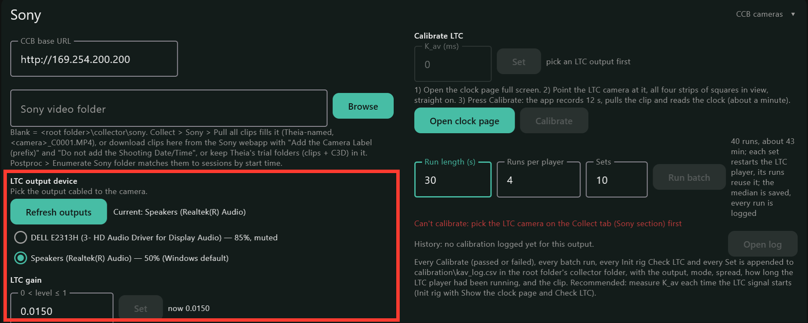

# Sony Cameras and Theia

## Key terms

- **LTC (linear timecode):** a timecode signal carried as audio. The Collector
  plays it from a PC audio output into one camera's microphone input, so that
  camera's clip carries PC time in its audio.
- **LTC camera:** the one camera with the audio cable from the PC.
- **K_av:** the offset between the LTC in a clip's audio and its video frames,
  from the audio output through the camera. Measured from the clock page.
- **Clock page:** a page the Collector opens in the browser showing the PC clock
  with strips of squares; the LTC camera films it to measure K_av.
- **Timecode:** the time each camera stamps on its video, set by its control box.
- **Control box (CCB):** Sony's CCB-WD1 camera control box, one per camera. The
  first is the master, which the Collector talks to.
- **PTP (Precision Time Protocol):** how the control boxes share their clock over
  the camera network. The box clock the others follow is the **grandmaster**.
- **Browser key:** the control boxes' lock; whoever holds it controls the
  cameras. Init rig gets it for the Collector.

## How it connects

- The PC joins the cameras' network and talks to the Sony **camera control
  boxes** (one per camera; the first one is the master, usually
  `http://169.254.200.200`). The Collector starts and stops every camera and reads
  each camera's state.
- For the tightest timing, the Collector plays an **LTC** signal
  from a PC audio output into **one camera's microphone input**. That camera's
  clip then carries PC time in its audio.
- Every camera also stamps its video with **timecode**, set by the control box
  from its own clock when recording starts. The box shares that clock over
  the camera network by PTP; the Collector
  listens to it the whole time and saves it with each take, so every take can be placed
  on the PC clock even without LTC, though less precisely.

How precise each one is, and why, is in [Timing: LTC and PTP](#timing-ltc-and-ptp).

## Timing: LTC and PTP

With LTC, expect the video on the PC clock to within **one or two video
frames**, across takes. PTP is a fallback and a cross-check: good to about
**60 ms**. Where a study needs better than a frame or two, record a sync event
that every system sees, such as a tap on a LEVEL sensor or a step onto a force
plate, and line the systems up on it.

### LTC

- **Within a take, LTC holds.** The LTC is read all the way through the clip,
  so camera clock drift never builds up: under 10 ms over a 20-minute take.
- **Every LTC word is stamped with the PC time it is played.**
- **The remaining offset is K_av**, the delay from the PC clock through the
  audio output and the camera's microphone input to the video frame. It
  depends on the output, its driver and the camera, so the Collector measures
  it (see [Calibrate LTC on this PC](#calibrate-ltc-on-this-pc)).
- **The calibration itself is limited by the monitor.** It films the clock
  page on the PC's screen. The screen shows the time a little late, and now
  and then one whole screen refresh later (about 17 ms) for minutes at a time,
  so calibration results can fall into groups about 17 ms apart (one refresh
  at 60 Hz). The page also refreshes at 60 Hz while the camera
  records at 59.94 frames per second, so within one clip the reading slides
  back and forth by one refresh every few seconds; a calibration clip
  averages over that. Treat K_av as good to about a frame.

### PTP

- The control box sets each camera's timecode from its own clock (PTP). The
  timecode lands about **180 ms** after the box clock's time at the record
  start; the Collector knows this and corrects for it.
- What it cannot correct: between re-syncs the camera's timecode gains about
  **6.6 ms per minute** on the box clock, and the box pulls it back by about
  60 ms every 10 minutes, so a take's offset depends on where in that cycle it
  started (plus about 15 ms either way). That is the **about 60 ms**.
- The **first take after a camera is attached or powered on** can carry a
  timecode that is seconds stale. Wait 10 minutes after attaching or powering a
  camera before a take you will place by PTP alone. Do not restart a control
  box mid-session: its clock jumps and the cameras take minutes to follow.
- The Collector saves PTP with every take, LTC or not. When a take has both,
  Align warns if they disagree by more than 50 ms.
- The Collector needs to hear the box clock: allow UDP ports 319 and 320 (see
  below) and keep the boxes sending it (see the FAQs).

## Setup

You need:

- Sony **RX0 II** cameras, each on a **CCB-WD1 camera control box**, wired
  through a network switch, with the Collector PC on that network;
- one **audio cable** from a PC audio output to the microphone input of one
  camera (the LTC camera). A built-in headphone jack or a **USB audio
  adapter** both work; some built-in jacks cut out when a camera is plugged
  in, even though they work with headphones, and then a USB adapter is the fix;
- the Collector with the **full** Python environment (see
  [Settings](windows-settings.html#python-interpreter));
- a **Sony video folder** on the PC. By default it is `collector\sony` in the
  root folder (`C:\lvlmotion\collector\sony`); **Settings > Sony** can point it
  elsewhere. **Pull all
  clips** on the Collect tab fills it (see below), or download the clips from
  the webapp the way Theia asks: **Add the Camera Label (prefix)** and **Do not
  add the Shooting Date/Time**, so they are named `<label>_C0001.MP4` (Theia's
  example: `8_C0001.MP4`; see Theia's
  [Format Sony Multicam](https://docs.theiamarkerless.com/theia3d-documentation/theia3d-dropdown-menus/tools-menu/format-sony-multicam)
  and [Organize Videos](https://docs.theiamarkerless.com/theia3d-documentation/theia3d-dropdown-menus/tools-menu/organize-videos)).
  Theia's organized trial folders (the clips plus the C3D) can live in the same
  folder.

We assume the rig already records on its own through the Sony webapp: cabling,
firmware, the master box and timecode sync are set up as Sony and Theia
describe:

- Sony: [CCB-WD1 Help Guide](https://helpguide.sony.net/dsc/1760/v1/en/index.html)
  and the RX0 II's [camera control boxes](https://helpguide.sony.net/dsc/1910/v1/en/contents/TP0002088375.html)
  page (USB Connection: PC Remote).
- Theia: [Sony Camera Package system setup](https://docs.theiamarkerless.com/theia3d-documentation/sony-camera-package/system-setup)
  and [data collection](https://docs.theiamarkerless.com/theia3d-documentation/sony-camera-package/data-collection).

What the Collector needs on top of that, once per rig:

- On the **LTC camera** (camera menu, Movie settings): **Audio Recording: On**
  (Theia's usual camera setup turns audio off, which removes the LTC);
  **Audio Rec Level: manual, about 26 of 30** (automatic level spoils the
  signal); **Audio Level Display** on if you want to see the LTC arriving.
  Plugging the cable into the microphone jack turns off that camera's own
  microphone.
- On the **PC**, turn off **Audio enhancements** for the LTC output (Windows
  **Settings > System > Sound**, pick the output, **Audio enhancements: Off**).
  Enhancements level the signal automatically and spoil the LTC. On the same
  output's **Advanced** page, leave **Allow applications to take exclusive
  control** on: the Collector needs it to play LTC.
- Allow **UDP ports 319 and 320** through Windows Firewall on the camera
  network, so the Collector can hear the control box clock (PTP).

In the Collector's **Settings** tab:

1. **Settings > Sync:** tick **Sony**, with the Collector as master.
2. **Settings > Sony:** the control box address (**CCB base URL**); the **LTC
   output** (press **Refresh outputs**, then pick the output cabled to the
   camera); the **LTC gain** (type it and press **Set**). Start at **0.015**
   with the output's Windows volume at 50%.

<strong>RETAKE SCREENSHOT #12 (on 0.1.42+): Settings > Sony panel without the auto-get browser key checkbox, and with the single-backslash folder hint</strong>

### Calibrate LTC on this PC

K_av is the offset between the LTC in the audio and the video frames. The
Collector measures it by filming the **clock page**, a page that shows the PC
clock with two strips of squares above it and two below:

Before the first session on a PC, and again after changing the PC, the LTC
output, the audio adapter or the LTC camera, calibrate in **Settings > Sony**,
under **Calibrate LTC**. Until then the Collector uses 0 ms and Settings says
"default 0 ms, not yet set for this output" in red. The value is kept per LTC
output and per version of the Collector's LTC player, so a Collector update
that changes the player asks for a new calibration.

1. Press **Open clock page** and make the page full screen.
2. Point the LTC camera at the screen, straight on, with all four strips in
   view.
3. Press **Calibrate**. The Collector plays LTC, records 12 seconds, copies the
   clip and reads the clock from the video. After about a minute it shows the
   result, for example "K_av = -68 ms (spread 5 ms)", and saves it for that LTC
   output. If the camera missed the recording, the run fails rather than
   reading an older clip. You can also type a measured value into **K_av (ms)**
   and press **Set**.

To see how steady the value is on this PC, run a **batch** (the row under
Calibrate): **Run length (s)** (60 by default), **Runs per player** (4) and
**Sets** (100). Each set restarts the LTC signal, a fresh start of the output,
then records that many runs on it. The line beside **Run batch** shows how many
runs that is and about how long; the defaults take most of a night, so lower
**Sets** for a quick check. **Stop** ends the batch after the current run. The
median of the runs that read the clock page is saved.

Every Calibrate, every batch run, every value you **Set** by hand and every
Check LTC that decoded is added to a log, `calibration\kav_log.csv` in the
collector folder (**Open log** opens its folder). The **History** line under the
buttons sums it up for the picked output: how many calibrations, their median,
spread, range and the last value. If the values fall into separate groups, a
red note says which kind:

- **whole screen refreshes apart** (about 17 ms): the clock page's display
  delay changed between runs, not the LTC;
- **not whole refreshes apart**: this output does not start at the same offset
  every time.

Camera calibration (intrinsic, extrinsic) is Theia's, as in Theia's
[calibration pages](https://docs.theiamarkerless.com/theia3d-documentation/data-collection/recording-extrinsic-chessboard-calibrations).

## Scan

On the **Collect** tab, the Sony panel lists the cameras as the webapp names
them (e.g. `001  DSC-RX0M2_3177801`) with each camera's state. The list is
live, so there is nothing to scan; **Scan All** leaves Sony alone.

1. Pick the **LTC** camera: the one with the audio cable.
2. The **ptp** line in **Rig details**, under the cameras, should read
   **grandmaster heard** with the clock offset.

<strong>RETAKE SCREENSHOT #5: current Sony panel with Init rig and Pull all clips, PTP line inside Rig details, stamped player (no FREE-RUNNING)</strong>

## Initialize

**Init rig…** on the Sony panel gets the cameras and the LTC ready at the
start of a session, and measures K_av for this start of the LTC signal.

1. Press **Init rig…**. A checklist comes up, in
   the order the steps run, grouped by where each step happens:
   - This PC: **open the camera page in the browser** (the Sony webapp, for
     live previews), then **show the clock page**;
   - Cameras, through the control box: **keep the boxes' timing (PTP) running
     from this app** (off by default; see the FAQs), get the browser key,
     power on any camera that is off, one-push autofocus on every camera, and
     link the cameras' clocks to the PC;
   - This PC: unmute the LTC output and set it to 50%, start playing the LTC
     signal, and **Check LTC**;
   - Cameras: **format every camera's memory card**, last, so the session
     starts on empty cards.

   Untick what you do not want and press **Run** (it reads **Run (formats
   cards)** while the format is ticked). The cameras it will touch are listed.
   Pull the clips first if anything on the cards is still needed. While it
   runs, the panel shows one line per step under the buttons: running, done or
   failed, with what the step reported.
2. When the clock page opens, make it full screen and point the LTC camera at
   it, as in [Calibrate LTC on this PC](#calibrate-ltc-on-this-pc). You have
   until **Check LTC** starts, after the camera steps.
3. **Check LTC** records 12 seconds on the LTC camera, pulls the clip and reads
   the LTC in it: **OK** with the frame count and audio level, or what went
   wrong and what to change. From the same clip it reads K_av off the clock
   page; its line ends with, for example, "K_av = -68 ms (spread 5 ms) —
   saved". Point the camera back at the capture area.

**Measure K_av every time the LTC signal starts.** Init rig starts it, so keep
**Show the clock page** and **Check LTC** ticked (both are on by default).
**Play LTC signal** on the Sony panel is off at every launch and stays on until
you untick it; unticking it asks first, because once it plays again you need
another Init rig with those two steps. Each take saves the K_av in effect when
it was recorded, and Align uses that value (see [Postproc](#postproc)).

While LTC plays, the Collector takes the LTC output for itself (WASAPI
exclusive mode), so no other sound can land on the signal and the timing is
the same every time LTC starts. It never shares the output: if it cannot take
it, LTC does not start and the log says why. Usually the output is not an
active playback device, exclusive control is turned off for it in Windows
Sound > Advanced, or another program is holding it; fix that and tick **Play
LTC signal** again.

## Collect

**Start Stream** starts every camera through the control box and **Stop
Stream** stops them; the LTC plays into the LTC camera throughout if it is on.
The Sony card in the sidebar shows cameras ready, recording, or a problem, and
**Rig details** (under the Sony panel on the Collect tab) always shows the full
control-box status; its heading turns red with the number of problems when
something is wrong. If you start a take with Sony on but **Play LTC
signal** off, the log warns that the take will align without LTC.

<strong>RETAKE SCREENSHOT #7: current Sony panel during a take (no Get Browser Key / Link Date/Time / Unmute buttons)</strong>

## Files generated

| File | When | What |
|---|---|---|
| `sony-anchor.json`, `sony-events.csv` | at Stop | when the start and stop were sent and confirmed, on the PC clock |
| `timestamps-sony_ptp.csv` | at Stop | timestamps only: the control box clock next to the PC clock, about once a second, from 5 minutes before the start to about 2.5 minutes after the stop |
| `<camera>_<clip>.MP4` | after Align | the LTC camera's clip, in the Sony video folder |
| `aligned\sony_frames_pc.csv` | after Align | every video frame of the LTC camera's clip with its PC time |
| `aligned\sony_frames_pc-<serial>.csv` | after Align | the same for each other camera's clip of the take (`<serial>` is the camera's serial number) |
| `aligned\sony-clock.csv` | after Align | the camera timecode worked out from the control box clock, next to the PC clock |
| `aligned\theia_frames_pc.csv` | after Align | every Theia frame with its PC time (when a Theia C3D is present) |
| `aligned\pc_alignment.json` | after Align | the method and quality for every system |

The clips themselves stay on the cameras' cards until you copy them. At the
end of a session press **Pull all clips…** on the Collect tab. A short
checklist comes up: **pull all files off every camera into a new dated
folder** (ticked), and **power off the cameras** afterwards (not ticked; it is
skipped if any clip fails to pull, so nothing is left only on a card). Under
**Pull from** every camera on the rig is listed and ticked; untick any you do
not want. Press **Run**. Every clip on the ticked cameras is copied into a new
dated folder under the Sony video folder (`2026_10_16_15_02_11\`, say), named the way Theia asks
(`DSC-RX0M2_3177801_C0001.MP4`), and the Postproc table is refreshed. The
Sony panel lists each camera and its clips as they come in. The dated folder
matters: after a format the cameras number clips from `C0001` again, so each
pull keeps its own folder. **Cancel pull** stops between clips; a pull can
take a long while (about 12 MB/s per camera). The LTC camera's clip can also
be pulled by Align on its own while the rig is still connected. Everything
Align writes goes to `aligned\<session>\` beside `data\` in the collector
folder; the session's raw files are never changed.

## Postproc

A typical session: record one take, pull its clips and align it to check that
everything lines up, then record the rest and pull and align them all together
at the end. Align runs only when you press **Run on ticked**.

**Postproc > Align to PC clock** puts the external systems on the PC clock;
the sensor files are already on it and are not changed. The table has a **Raw**
column (what each session holds, per system: folder and files) and an
**Aligned** column (what the last run wrote). Each finished take is added to the
table by itself; the buttons do the rest:

- **Enumerate** lists every session under `data\`, then goes through the clips
  in the Sony video folder and in each dated **Pull all clips** folder under
  it. The clips with the same number (`C0001`, say) from every camera in one
  folder are one take. The take is timed by the LTC in its clips (the camera
  the sessions name as the LTC camera is tried first) or, for a **Pull all
  clips** folder, by the time the cameras wrote the clips, and attached to the
  session that started at the same time (within 5 minutes). The camera
  timecode is never used for this: one camera can carry a timecode that is far
  off with nothing to show it. A take with neither LTC nor a pull time is
  skipped, and the log says so. A Theia trial folder is timed only by the LTC in
  its first clip (by name) and fills the Theia line with its C3D; if that clip
  has no LTC, the folder is skipped. A take with no
  session becomes a row of its own, named from when it started (for example
  `2026_10_16_15_58_18-C0001`), aligned by LTC alone.
- **Run on ticked** runs the ticked rows in order.

For each ticked take the run:

- pulls the LTC camera's clip off the camera if no clip is known for the take
  yet (into the Sony video folder);
- writes `aligned\sony_frames_pc.csv`: every video frame with its PC time, and
  the method used for the take:
  - **ltc** - from the LTC in the clip's audio (within about one video frame);
  - **ptp** - from the control box clock saved during the take (to about 60 ms;
    see [PTP](#ptp));
  - **trigger** - from when the Collector sent the start to the cameras, plus
    the cameras' usual start delay (to about 35 ms);

  with none of the three, no frame times are written and a red line under the
  take says why;
- writes `aligned\sony_frames_pc-<serial>.csv` the same way for each other
  camera's clip of the take, from that clip's own LTC if it has any, else PTP,
  else the trigger;
- writes `aligned\pc_alignment.json` with the result and any warnings for every
  system.

For the **ltc** method, Align uses the K_av the take saved when it was
recorded; a take that saved none uses the current calibration. Tick **Sony: use
the current K_av calibration instead of the one each take recorded** above the
table to re-align old takes with today's value. If the LTC signal lost time
during a take (the PC's audio stalled), the log says how much ("LTC player
gapped ... ms"); the LTC timing of the take is still good.

**Theia.** Theia processes the clips into a motion file
([C3D](https://docs.theiamarkerless.com/theia3d-documentation/data-formats/c3d-files))
whose frames are the video's frames. Keep Theia's trial folders (clips plus
C3D) in the Sony video folder and press **Enumerate** again: the C3D shows in
the Theia line, and the next run writes `theia_frames_pc.csv`
with the PC time of every Theia frame.

## FAQs

**The Sony line in the Aligned column reads PTP or TRIGGER instead of LTC.**
The LTC did not decode; the log says why. Try, in this order:

1. turn off Windows Audio enhancements on the LTC output;
2. Windows volume 50% and LTC gain about 0.015;
3. lower the camera's Audio Rec Level;
4. use a USB audio output instead of a laptop headphone jack;
5. check the cable sits in the LTC camera's microphone input.

**Start Stream does nothing on the cameras.** The Collector has lost its hold
on the control box. Press **Init rig…**, untick everything but **Get the
browser key**, and press **Run**.

**The PTP line says "not heard".** Allow UDP ports 319 and 320 in Windows
Firewall on the camera network. If it still says "not heard", keep the camera
page open in the browser (the first step of **Init rig…**), or run Init rig
with **Keep the boxes' timing (PTP) running from this app** ticked: without
either, the control boxes can stop sending their clock. Until then, takes
align from LTC or the start trigger only.

**A long take came back as several files.** The camera's memory card is
formatted FAT32, which splits clips at about 4 GB. Format the cards in the
camera (exFAT) to keep one file per take.

**No sound comes out of the LTC output for anything else.** That is the
exclusive mode while LTC plays; it returns when LTC stops.
