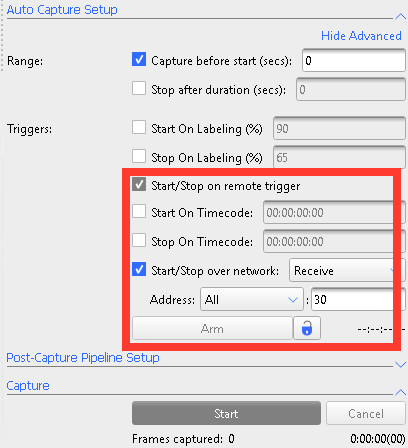
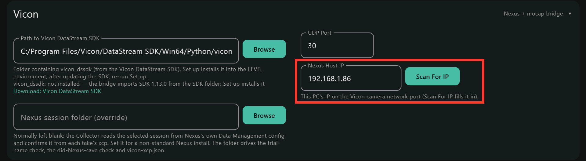

# Vicon

## Key terms

- **Nexus:** Vicon's capture software.
- **Live mode:** Nexus streaming its cameras' data as it happens, both standing
  by and while capturing. The Collector only gets frame timing in Live mode.
- **Vicon DataStream SDK:** Vicon's free software for reading Nexus's live data.
  The Collector uses its Python part.
- **Arm / Lock:** buttons in Nexus's Capture Tools. **Arm** makes Nexus wait for
  a start over the network; **Lock** keeps it armed after each capture.
- **Start/Stop over network:** the start and stop messages the Collector sends
  to Nexus (UDP port 30 by default).
- **Trial file (.xcp):** the file Nexus saves for each trial, with its capture
  start and end times.
- **C3D:** the usual motion-capture export file (markers, force plates).

## How it connects

- **Start and stop** travel over the network as Nexus's remote-trigger messages
  (UDP port 30 by default): the Collector starts and stops Nexus.
- **Frame timing:** once you press **Connect to Nexus**, the Collector reads
  Vicon's live data stream and, during each take, saves every Vicon frame number
  with the PC time it arrived. That places anything Nexus records on its own
  frames (markers, force plates) on the PC clock.
- **Capture check:** the Collector watches the Nexus session folder: it refuses
  a trial name Nexus already has, and confirms that Nexus saved each trial.
- **Force plates** wired into the Vicon system are recorded by Nexus, on Vicon's
  frames.

## Setup

You need:

- a Vicon system with **Nexus 2** calibrated and capturing as your lab normally
  does, with the Collector installed on the Nexus PC. All capture happens on
  that one PC: running Nexus on a second PC is not supported;
- the **Vicon DataStream SDK** installed on the Collector PC (free from
  [vicon.com](https://www.vicon.com/software/datastream-sdk/); the default
  folder is `C:\Program Files\Vicon\DataStream SDK\Win64\Python\vicon_dssdk`);
- the Collector's own Python environment, set up with either **Set up**
  button (see [Settings](windows-settings.html#python-interpreter)). Set up
  installs Vicon's Python package from the DataStream SDK folder; after updating
  the SDK, run Set up again.

We assume you already run captures in Nexus on your own: camera calibration,
subjects and force plates are Vicon's business, see
[Vicon Help](https://help.vicon.com/). The only Nexus settings this page adds
are the ones that let the Collector start and read a capture, in Nexus's
**Capture Tools** pane (Vicon's description:
[Capture tools, Nexus 2.16](https://vicon-help.atlassian.net/wiki/spaces/Nexus216/pages/11602304/Capture+tools)):

- **Start/Stop over network** (called **Start/Stop on remote trigger** in older
  Nexus): on, set to **receive**, on the same UDP port as the Collector (30).
- Press **Arm** before the first take, and **Lock** so Nexus stays armed after
  each capture stops.
- Nexus in **Live** mode with the cameras running. The frame timing only flows
  while Nexus streams live data.
- Force plates enabled and zeroed before each take.
- A session selected in Nexus's **Data Management**. The Collector reads it to
  check trial names and that each trial was saved.

In the Collector's **Settings** tab:

1. **Settings > Sync:** tick **Vicon**, with the Collector as master.
2. **Settings > Vicon:** **UDP Port** (match Nexus; 30 by default), **Nexus
   Host IP** (**Scan For IP** fills in this PC's address on the Vicon camera
   network; Nexus does not hear start and stop sent to `127.0.0.1`) and **Path to
   Vicon DataStream SDK**. Leave **Nexus session folder (override)** blank: the
   Collector finds the session Nexus has selected.

   

Calibrate Vicon and take a static trial as your lab normally does (see
[Vicon Help](https://help.vicon.com/)).

## Scan

Nothing to scan: **Scan All** leaves Vicon alone.

## Initialize

Put Nexus in **Live**. On the **Collect** tab's Vicon panel, press **Connect to
Nexus**. The **Data** line reads "● ready — DataStream ... Hz" and the Vicon
card in the sidebar turns green. The **Nexus session** line shows the Nexus
folder the Collector is watching.

Then do a short test take: the Vicon card in the sidebar should
stay **green**, reading "receiving — frame ..." at about the Vicon frame rate.

## Collect

**Start Stream** starts Nexus and **Stop Stream** stops it. Nexus uses the
Collector's trial name; `trial01`, `trial02`, ... move on by themselves after
each take. After the stop, the Collector waits up to 10 seconds for the trial
file Nexus saves in its session folder (it usually appears within a second);
if none appears, the Vicon panel says "Nexus did not save ..." in red.

Use a new trial name for every take. Nexus silently overwrites a trial with the
same name, so the Collector does not start a take whose name Nexus already has
in its session folder, and says so in red.

Between takes the Vicon card stays green ("ready") while Nexus is Live. Grey
"not connected" means **Connect to Nexus** has not been pressed yet; yellow
means the Collector is connected but no frames are coming ("is Nexus Live?").

## Files generated

| File | What |
|---|---|
| `vicon-anchor.json` | trial name and the PC time of the start trigger |
| `timestamps-vicon.csv` | timestamps only: Vicon frame (1 = the take's first frame), subframe, PC time in microseconds, and the live stream's own frame counter |
| `vicon-debug.csv` | extra live-stream details per frame, for troubleshooting |
| `vicon-xcp.json` | the trial's capture start and end times, copied from the trial file Nexus saves |
| `<trial>.xcp` | a copy of the trial file Nexus saves |
| `bridge.log` | log of the live-data reader (send it to us if frames are missing) |
| `aligned\vicon_frames_pc.csv` | after Align: every Vicon frame with its PC time |

Marker and force-plate data come from your Nexus export as usual (C3D or CSV);
keep the trial name so it matches the session folder.

## Postproc

Align writes to `aligned\<session>\` beside `data\` in the root folder's
`collector` folder (by default `C:\lvlmotion\collector\aligned\`); the raw
session folder is never changed.

- `timestamps-vicon.csv` lists every Vicon frame with the PC time it arrived
  (timestamps only; marker data comes from your Nexus export).
- **Postproc > Align to PC clock** fits a line through those arrivals and writes
  `aligned\vicon_frames_pc.csv`: every Vicon frame with its PC time. If a Nexus
  C3D is in the session folder, its frame range is covered too. Use it to place
  any Nexus export (C3D, force plates) on the PC clock by frame number.

## FAQs

**Start Stream does nothing in Nexus.** Nexus is not armed, or the port or
network interface differs. Check **Start/Stop over network** is on, receiving,
on port 30, and press **Arm**. **Lock** keeps it armed for the next take.

**The Vicon card stays grey or turns red during a take.** The live stream is
not reaching the Collector: Nexus must be in Live mode, the Collector must run
on the Nexus PC, and **Connect to Nexus** must have been pressed (the Collector
tries to connect at Start Stream if you forgot, but the take may start without
frame timing).

**The Vicon panel says "Nexus did not save ...".** Nexus did not record the
trial, or saved it outside the session the Collector is watching (the **Nexus
session** line). Check the points under "Start Stream does nothing in Nexus"
above, and that **Nexus Host IP** is this PC's Vicon network address.

**The Vicon panel says "Nexus already has a trial named ...".** Change the
trial name and start again.

**The Vicon panel says "frame counter restarted ... redo the take".** Nexus
re-synced its cameras during the take, so its frame numbers repeat. Record the
take again.

**Frames are missing in `timestamps-vicon.csv`.** Send us `bridge.log` from the
session folder.

**Can Nexus start the take instead?** Yes: in **Settings > Sync** make Vicon the
master and set Nexus to **send**. The Collector then follows Nexus's trigger
and takes the trial name from Nexus (the trial name box then reads **Trial Name
(Set By Nexus)** and is greyed). Ticking **Arm This Session (Listen For Nexus
Trigger)** in the Collect tab's Vicon panel makes it listen (the start button
then reads **Listening For Vicon**).
**Auto-arm by default** in **Settings > Vicon** ticks it for you.
